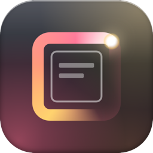
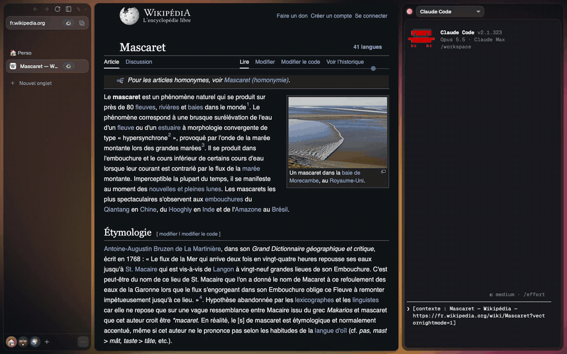
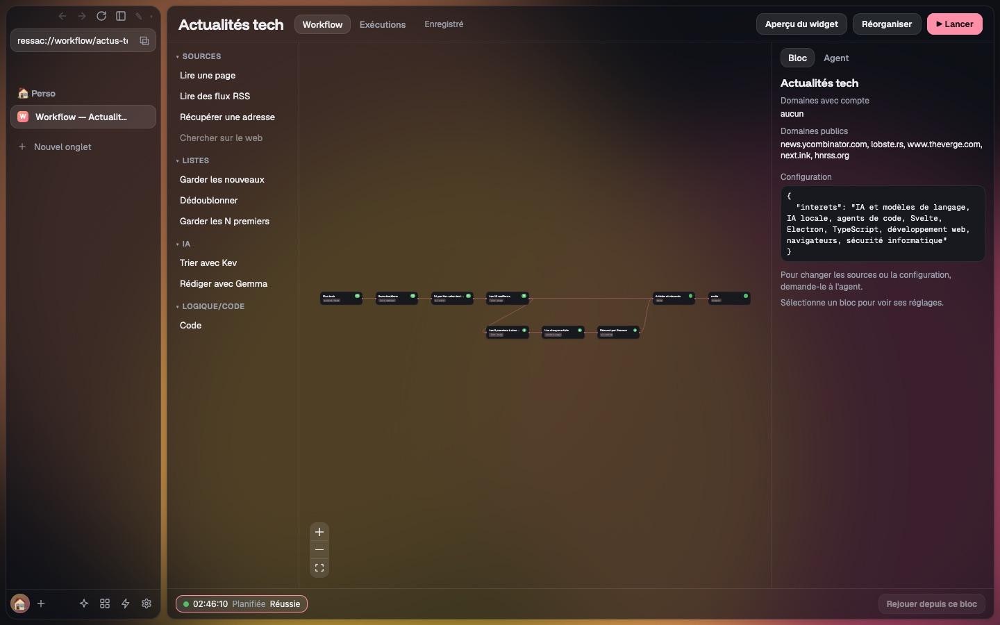
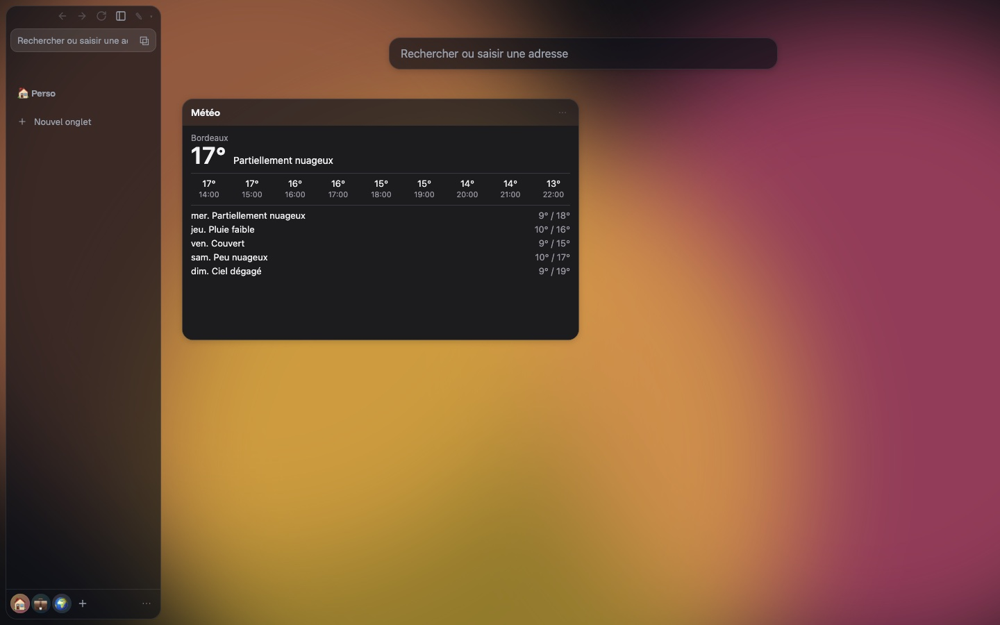

<p align="center">
  
</p>

<h1 align="center">Ressac</h1>

<p align="center">
  <strong>Un navigateur qui grandit avec toi.</strong><br>
  Sobre au départ. L'IA quand tu en as besoin.<br><br>
  <a href="README.md">Read in English</a>
</p>

<p align="center"><sub>Bêta fermée · macOS 14+ · Apple Silicon · Open source</sub><br><a href="https://getressac.app/fr/#invite"><b>Rejoindre la bêta</b></a></p>

<p align="center"></p>

## Le premier jour : juste un navigateur calme

Firefox sous le capot, une barre latérale discrète, rien à créer, rien à activer.

- Une barre latérale verticale avec des **essentiels** toujours chargés, des onglets épinglés et des dossiers.
- L'import depuis Arc, Chrome, Brave, Edge, Vivaldi, Opera, Safari, Firefox et Zen, espaces et onglets ouverts compris.
- Les extensions Firefox fonctionnent.
- Une barre pour les appels (Meet, Teams, Zoom…) et pour le son ou la vidéo en arrière-plan.

## À ta façon : espaces, auras, raccourcis

- Des **espaces**, chacun sa couleur, son aura, et ses propres comptes si tu veux.
- Une barre de commande sur <kbd>⌘T</kbd> / <kbd>⌘L</kbd> pour les adresses, favoris, historique, onglets et actions ; <kbd>⌃Tab</kbd> pour passer d'un onglet récent à l'autre.
- Des raccourcis modifiables et un mode Vim en option.
- Des **applis de site** : un site dans sa propre fenêtre, avec ses propres comptes, qui se souvient où tu en étais.

## Quand tu es prêt·e : active l'IA

Le *ressac*, c'est la vague qui revient vers le rivage. Tu envoies l'agent sur le web, il te revient avec la réponse.

**Un agent qui navigue avec toi**
- Claude Code ou Codex tourne dans un conteneur isolé sur ton Mac, avec **ton propre compte**.
- Il navigue dans son propre onglet, que tu peux regarder ; une vignette montre ce qu'il fait pendant que tu continues.
- Avant un achat ou un choix, il remplit un **récap en direct** : critères, sources indépendantes, offres, avantages et inconvénients sourcés.
- Il demande avant d'ouvrir une adresse qu'il a écrite lui-même, et te rend la main quand une page a besoin de toi (connexion, captcha).
- Il te crée des applis de site, des actions, des extensions et des widgets, et change l'apparence d'une page à la demande (mode design).

<p align="center"></p>

**L'IA locale**
- Des **workflows** et des **veilles** qui tournent sur ton Mac avec Ollama : un petit modèle décide, un autre écrit.
- Une page d'accueil avec des widgets.

<table>
  <tr>
    <td width="50%"><br><sub>L'agent lit ses sources pendant que son récap se remplit</sub></td>
    <td width="50%"><br><sub>La barre de commande ⌘T</sub></td>
  </tr>
  <tr>
    <td width="50%"><br><sub>Un workflow, bloc par bloc</sub></td>
    <td width="50%"><br><sub>Une appli de site dans sa fenêtre</sub></td>
  </tr>
  <tr>
    <td width="50%"><br><sub>L'accueil, ses widgets et les espaces en bas de la barre latérale</sub></td>
    <td width="50%"><br><sub>La barre d'appel en bas de la barre latérale</sub></td>
  </tr>
</table>

## Local et ouvert

- **Pas de compte.** Ressac n'en demande aucun. L'agent utilise ton propre compte Claude ou ChatGPT, une clé d'API, ou des modèles locaux.
- **Ta navigation reste sur ton Mac.** L'agent ne voit que les pages qu'il ouvre dans son onglet et ce que tu lui donnes.
- **L'IA reste éteinte tant que tu ne l'actives pas.** Docker, Ollama et l'agent ne démarrent qu'une fois que tu as dit oui.
- **Open source.** Construit sur Firefox, sous licence MPL 2.0.

Pendant la bêta, Ressac envoie à son développeur les plantages et les erreurs (sans adresse de page) et un identifiant d'installation anonyme, pour corriger les bugs ; désactivable dans Réglages › Vie privée.

## Obtenir Ressac

Ressac est en bêta fermée, avec un petit groupe de testeurs. Ils reçoivent un DMG signé et notarisé par Apple, puis Ressac se met à jour tout seul. **Pour en faire partie, demandez une invitation sur [getressac.app](https://getressac.app/fr/#invite).**

- **Pour naviguer** : macOS 14 ou plus récent, puce Apple.
- **Pour l'agent** : Docker ([OrbStack](https://orbstack.dev) ou Docker Desktop) et un compte Claude ou ChatGPT (ou une clé d'API). Ressac démarre lui-même l'app de conteneurs si elle est installée.
- **Pour l'IA locale** : [Ollama](https://ollama.com). Ressac le démarre, ou le télécharge pour toi (190 Mo).

Tu viens de WebAiOs, l'ancien nom de Ressac ? Quitte-le d'abord : au premier lancement, Ressac reprend tes données, ton profil, tes mots de passe et tes extensions.

## Compiler depuis les sources

Ressac se compile avec [surfer](https://github.com/zen-browser/surfer), qui télécharge Firefox et applique les patches de Ressac. Il faut macOS sur puce Apple, les outils en ligne de commande de Xcode, Python 3.10+, Rust, GNU tar, Node 22 et pnpm (via corepack), et environ 25 Go de disque.

```sh
corepack pnpm install
corepack pnpm --filter firefox-ressac engine:install   # télécharge Firefox, hors du dépôt
corepack pnpm --filter firefox-ressac engine:import    # applique les patches
corepack pnpm --filter firefox-ressac build            # build complet, environ 20 min
```

Commence par [docs/ARCHITECTURE.md](docs/ARCHITECTURE.md) pour une carte du code. Le reste (builds de l'interface seule, tests, paquet, chaque mécanisme) est dans [apps/firefox/README.md](apps/firefox/README.md). Ces documents sont en anglais. Les règles visuelles sont dans [docs/DESIGN.md](docs/DESIGN.md).

## Contribuer

Voir [CONTRIBUTING.md](CONTRIBUTING.md). Une faille de sécurité ? Signale-la en privé, voir [SECURITY.md](SECURITY.md).

## Crédits

Ressac repose sur le travail d'autres projets :

- [Firefox](https://www.mozilla.org/firefox/) de Mozilla (MPL 2.0), le moteur et l'essentiel du navigateur.
- [surfer](https://github.com/zen-browser/surfer) de l'équipe de Zen Browser (MPL 2.0), l'outil de build.
- [Node.js](https://nodejs.org) et [node-pty](https://github.com/microsoft/node-pty) (MIT), embarqués pour l'hôte de l'agent.
- [Ollama](https://ollama.com) (MIT), pour les modèles locaux, téléchargé à la demande.
- [Gemma 4](https://ai.google.dev/gemma) de Google et pplx-decider-flash de Perplexity (Apache 2.0), modèles locaux téléchargés à la demande.
- [Claude Code](https://claude.com/claude-code) d'Anthropic et [Codex](https://github.com/openai/codex) d'OpenAI, les agents, installés dans le conteneur et utilisés avec ton propre compte.
- [Svelte](https://svelte.dev), [Vite](https://vite.dev), et les polices [Geist](https://vercel.com/font) et [Funnel Display](https://fonts.google.com/specimen/Funnel+Display) (OFL).

La liste complète des licences tierces embarquées est dans l'application, dossier `Contents/Resources/ressac-host/LICENSES`.

## Licence

[Mozilla Public License 2.0](LICENSE). Le nom Ressac et son logo ne sont pas couverts par la licence.
