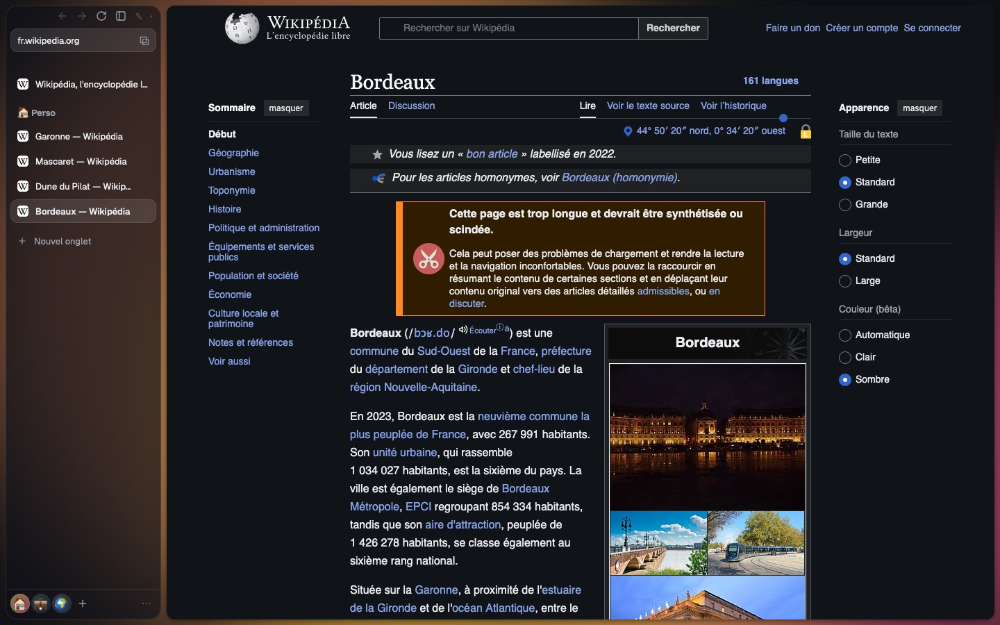
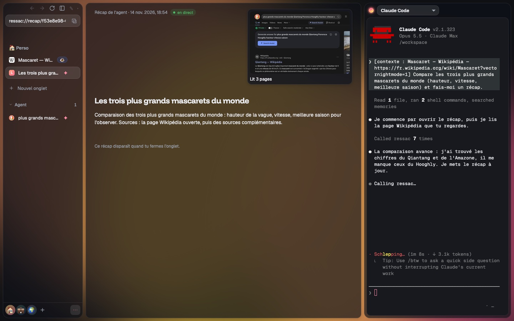
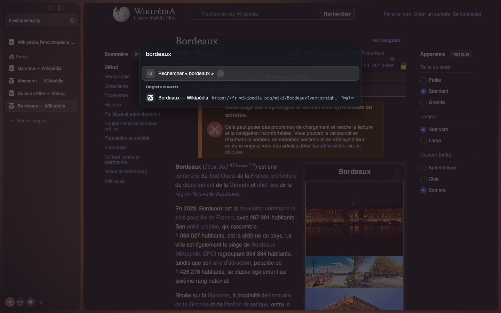
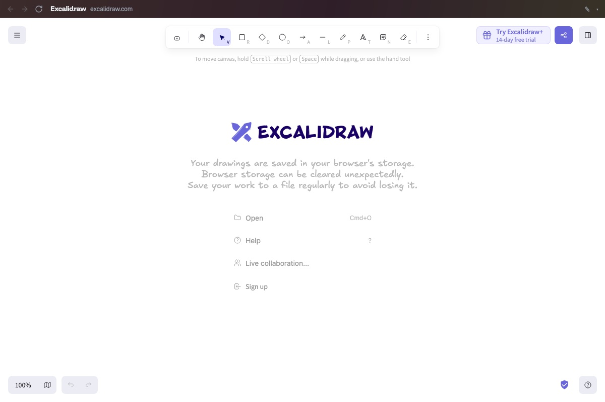
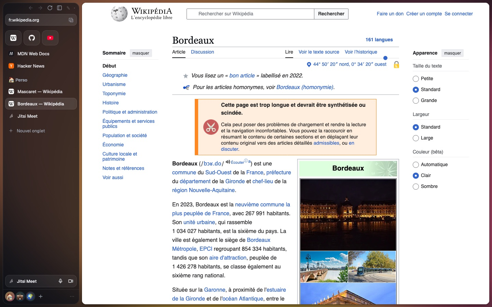

<p align="center">
  
</p>

<h1 align="center">Ressac</h1>

<p align="center">
  <strong>Un navigateur qui grandit avec toi.</strong><br>
  Sobre au départ. L'IA quand tu en as besoin.<br><br>
  <a href="README.md">Read in English</a>
</p>

<p align="center"><sub>Bêta fermée · macOS 13.3+ · Apple Silicon · Open source</sub><br><a href="https://getressac.app/fr/#invite"><b>Rejoindre la bêta</b></a></p>

<p align="center"></p>

Ressac a trois niveaux, que tu actives toi-même : **Navigateur** (sans IA), **IA** (l'agent et ses protections) et le **Labo** (des outils expérimentaux pour aller plus loin). Ce sont de vraies frontières : ce qui est éteint ne tourne pas.

## Niveau 1, le premier jour : juste un navigateur calme

Firefox sous le capot, une barre latérale discrète, rien à créer, rien à activer.

- Une barre latérale verticale avec des **essentiels** toujours chargés, des onglets épinglés et des dossiers.
- L'import depuis Arc, Chrome, Brave, Edge, Vivaldi, Opera, Safari, Firefox et Zen, espaces et onglets ouverts compris.
- Les extensions Firefox fonctionnent.
- Une barre pour les appels (Meet, Teams, Zoom…) et pour le son ou la vidéo en arrière-plan.

## À ta façon : espaces, auras, raccourcis

- Des **espaces**, chacun sa couleur, son aura, et ses propres comptes si tu veux.
- Une barre de commande sur <kbd>⌘T</kbd> / <kbd>⌘L</kbd> pour les adresses, favoris, historique et onglets ; <kbd>⌃Tab</kbd> pour passer d'un onglet récent à l'autre.
- Des raccourcis modifiables et un mode Vim en option.
- Tes mots de passe enregistrés dans les Réglages, derrière Touch ID.

## Niveau 2, quand tu es prêt·e : active l'IA

Le *ressac*, c'est la vague qui revient vers le rivage. Tu envoies l'agent sur le web, il te revient avec la réponse.

**Un agent qui navigue avec toi**
- Claude Code ou Codex tourne dans un conteneur isolé, avec **ton propre compte**, à l'intérieur d'une petite machine Linux que Ressac télécharge une fois (environ 500 Mo) et éteint après 5 minutes sans usage (réglable dans Réglages › Atelier). Au premier usage, Ressac télécharge aussi la version figée de l'agent choisi (environ 170 Mo), vérifiée par son SHA-256. Pas besoin de Docker.
- À ce niveau, l'agent n'a pas de terminal : il lit et écrit des fichiers dans son espace de travail, et navigue par Ressac.
- Il navigue dans son propre onglet, que tu peux regarder ; une vignette montre ce qu'il fait pendant que tu continues.
- Avant un achat ou un choix, il remplit un **récap en direct** : critères, sources indépendantes, offres, avantages et inconvénients sourcés.
- Il demande avant d'ouvrir une adresse qu'il a écrite lui-même, et te rend la main quand une page a besoin de toi (connexion, captcha).
- Il te crée des widgets pour ta page d'accueil.
- Il se sert de tes identifiants sans les voir : le masquage, un passeport pour ton nom et ton adresse, et « Cacher pour l'agent » pour tout ce que tu lui montres du doigt.

<p align="center"></p>

**La recherche locale, et les widgets**
- La **barre ⌘T** retrouve une page visitée par son sujet, en français comme en anglais, avec un petit modèle de recherche qui tourne sur ton Mac.
- Une page d'accueil avec des widgets. Ils trient et résument par ton agent : ton compte, une clé d'API ou ton Ollama (ça compte dans tes limites).

## Niveau 3, le Labo (expérimental)

Éteint par défaut ; il s'allume dans Réglages › Agent › Niveau d'usage, après avoir lu ce qu'il expose. Ses protections ont des limites connues, publiées dans [SECURITY.md](SECURITY.md).

- **L'Atelier** : l'agent a un terminal, pour construire et lancer des applis de projet.
- Des **workflows** et des **veilles**, et des **actions** à lancer depuis <kbd>⌘T</kbd>, avec du code écrit par l'agent.
- Des **applis de site** : un site dans sa propre fenêtre, avec ses propres comptes, qui se souvient où tu en étais ; et les applis de l'agent.
- Le **mode design** (changer l'apparence d'une page à la demande), le serveur MCP externe et les outils de développement de l'agent (`run_js`, console, réseau).

<table>
  <tr>
    <td width="50%"><br><sub>L'agent lit ses sources pendant que son récap se remplit</sub></td>
    <td width="50%"><br><sub>La barre de commande ⌘T</sub></td>
  </tr>
  <tr>
    <td width="50%"><br><sub>Un workflow, bloc par bloc</sub></td>
    <td width="50%"><br><sub>Une appli de site dans sa fenêtre</sub></td>
  </tr>
  <tr>
    <td width="50%"><br><sub>L'accueil, ses widgets et les espaces en bas de la barre latérale</sub></td>
    <td width="50%"><br><sub>La barre d'appel en bas de la barre latérale</sub></td>
  </tr>
</table>

## Local et ouvert

- **Pas de compte.** Ressac n'en demande aucun. L'agent utilise ton propre compte Claude ou ChatGPT, une clé d'API, ou des modèles locaux.
- **Ta navigation reste sur ton Mac.** L'agent ne voit que les pages qu'il ouvre dans son onglet et ce que tu lui donnes.
- **L'IA reste éteinte tant que tu ne l'actives pas.** La machine de l'agent, le modèle de recherche local et l'agent ne démarrent qu'une fois que tu as dit oui.
- **Open source.** Construit sur Firefox, sous licence MPL 2.0.

Pendant la bêta, Ressac envoie à son développeur les plantages et les erreurs (sans adresse de page) et un identifiant d'installation anonyme, pour corriger les bugs ; désactivable dans Réglages › Confidentialité.

## Obtenir Ressac

Ressac est en bêta fermée, avec un petit groupe de testeurs. Ils reçoivent un DMG signé et notarisé par Apple, puis Ressac se met à jour tout seul. **Pour en faire partie, demandez une invitation sur [getressac.app](https://getressac.app/fr/#invite).**

- **Pour naviguer** : macOS 13.3 ou plus récent, puce Apple.
- **Pour l'agent** : un compte Claude ou ChatGPT (ou une clé d'API, ou, si tu veux, ton propre [Ollama](https://ollama.com) pour des modèles locaux). Rien d'autre à installer : Ressac télécharge la machine de l'agent au premier usage.
- **Pour l'IA locale** : rien à installer. Quand tu actives l'IA, Ressac télécharge une fois son petit modèle de recherche, EmbeddingGemma (334 Mo), vérifié par son SHA-256. Le tri et les résumés des widgets et les pages d'actions sont écrits par ton agent (ton compte Claude Code ou Codex, une clé d'API ou ton Ollama), il faut donc que l'un d'eux soit prêt.

Tu viens de WebAiOs, l'ancien nom de Ressac ? Quitte-le d'abord : au premier lancement, Ressac reprend tes données, ton profil, tes mots de passe et tes extensions.

## Compiler depuis les sources

Ressac se compile avec [surfer](https://github.com/zen-browser/surfer), qui télécharge Firefox et applique les patches de Ressac. Il faut macOS sur puce Apple, les outils en ligne de commande de Xcode, Python 3.10+, Rust, GNU tar, Node 22 et pnpm (via corepack), et environ 25 Go de disque.

```sh
corepack pnpm install
corepack pnpm --filter firefox-ressac engine:install   # télécharge Firefox, hors du dépôt
corepack pnpm --filter firefox-ressac engine:import    # applique les patches
corepack pnpm --filter firefox-ressac build            # build complet, environ 20 min
```

Commence par [docs/ARCHITECTURE.md](docs/ARCHITECTURE.md) pour une carte du code. Le reste (builds de l'interface seule, tests, paquet, chaque mécanisme) est dans [apps/firefox/README.md](apps/firefox/README.md). Ces documents sont en anglais. Les règles visuelles sont dans [docs/DESIGN.md](docs/DESIGN.md).

## Contribuer

Voir [CONTRIBUTING.md](CONTRIBUTING.md). Une faille de sécurité ? Signale-la en privé, voir [SECURITY.md](SECURITY.md).

## Crédits

Ressac repose sur le travail d'autres projets :

- [Firefox](https://www.mozilla.org/firefox/) de Mozilla (MPL 2.0), le moteur et l'essentiel du navigateur.
- [surfer](https://github.com/zen-browser/surfer) de l'équipe de Zen Browser (MPL 2.0), l'outil de build.
- [Node.js](https://nodejs.org) et [node-pty](https://github.com/microsoft/node-pty) (MIT), embarqués pour l'hôte de l'agent.
- [EmbeddingGemma](https://ai.google.dev/gemma/docs/embeddinggemma) 300M de Google, le modèle de recherche de la barre ⌘T ; Ressac le télécharge lui-même depuis Hugging Face ([le GGUF Q8_0 de ggml-org](https://huggingface.co/ggml-org/embeddinggemma-300M-GGUF)), il n'est pas inclus. Gemma is provided under and subject to the Gemma Terms of Use found at [ai.google.dev/gemma/terms](https://ai.google.dev/gemma/terms).
- [llama.cpp](https://github.com/ggml-org/llama.cpp) (MIT), son `llama-server` est livré dans l'app et fait tourner EmbeddingGemma.
- [Claude Code](https://claude.com/claude-code) d'Anthropic et [Codex](https://github.com/openai/codex) d'OpenAI, les agents, téléchargés par Ressac au premier usage (versions figées, SHA-256 vérifié) et utilisés avec ton propre compte.
- [Svelte](https://svelte.dev), [Vite](https://vite.dev), et les polices [Geist](https://vercel.com/font) et [Funnel Display](https://fonts.google.com/specimen/Funnel+Display) (OFL).

La liste complète des licences tierces embarquées est dans l'application, dossier `Contents/Resources/ressac-host/LICENSES`.

## Licence

[Mozilla Public License 2.0](LICENSE). Le nom Ressac et son logo ne sont pas couverts par la licence.
