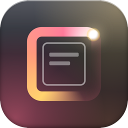

<p align="center">
  
</p>

<h1 align="center">Ressac</h1>

<p align="center">
  A macOS browser built on Firefox, with an AI agent at its side.<br>
  <a href="README.fr.md">Lire en français</a>
</p>

<!-- IMAGE 1: overview — sidebar with spaces, essentials, pinned tabs; agent panel closed. docs/images/overview.png -->

> **Beta.** Ressac is used every day by a small group of testers. Expect rough edges, and tell us about them.

*Ressac* is French for backwash: the wave that comes back to the shore. You send the agent out on the web, and it comes back with the answer.

## What it does

**A calmer browser**
- A vertical sidebar with **spaces**, each with its own colour, **essentials** that stay loaded, pinned tabs and folders.
- A command bar on <kbd>⌘T</kbd> / <kbd>⌘L</kbd> for addresses, bookmarks, history, tabs and actions; <kbd>⌃Tab</kbd> through recent tabs.
- Remappable shortcuts and an optional Vim mode.
- **Site apps**: a website in its own window, with its own logins, that remembers where you were.
- A bar for calls (Meet, Teams, Zoom…) and for audio or video playing in the background.
- Import from Arc, Chrome, Brave, Edge, Vivaldi, Opera, Safari, Firefox and Zen, spaces and open tabs included.
- Firefox add-ons work.

**An agent that browses with you**
- Claude Code or Codex runs in a sandboxed container on your Mac, with **your own account**.
- It browses in its own tab, which you can watch; a thumbnail shows what it is doing while you keep working.
- Before a purchase or a choice, it fills a **live recap**: criteria, independent sources, offers, sourced pros and cons.
- It asks before opening an address it wrote itself, and hands back control when a page needs you (a login, a captcha).
- It can build site apps, actions and add-ons for you, and change a page's look on request (design mode).

<!-- IMAGE 2: live recap — video (MP4, 15–25 s): the agent researches, its thumbnail floats over the page, the recap fills card by card. docs/images/live-recap.mp4 -->

**Local AI**
- **Workflows** and **watches** run on your Mac with Ollama: a small model decides, another one writes.
- A home page with widgets.

<!-- IMAGES 3–9: agent panel, ⌘T command bar, workflow builder, a site app, home and widgets, call bar, import. docs/images/*.png -->

## Install

Download the latest DMG from [Releases](../../releases), open it and drag Ressac to Applications. Ressac is signed and notarized by Apple.

- macOS 14 or later, Apple Silicon.
- **For the agent**: Docker ([OrbStack](https://orbstack.dev) or Docker Desktop) and a Claude or ChatGPT account (or an API key). Ressac starts the container app itself when it is installed.
- **For local AI** (optional): [Ollama](https://ollama.com). Ressac starts it, or downloads it for you (190 MB).

Coming from WebAiOs (Ressac's former name)? Quit it first: Ressac carries over your data, profile, passwords and add-ons at its first launch.

## Privacy

Your browsing data stays on your Mac. The agent only sees the pages it opens in its own tab and what you give it. Ressac sends crash and error reports (without page addresses) and an anonymous install id to its developer, to fix beta bugs; turn it off in Réglages › Vie privée.

## Build from source

Ressac is built with [surfer](https://github.com/zen-browser/surfer), which downloads Firefox and applies Ressac's patches. You need macOS on Apple Silicon, Xcode command line tools, Python 3.10+, Rust, GNU tar, Node 22 and pnpm (through corepack), and about 25 GB of disk.

```sh
corepack pnpm install
corepack pnpm --filter firefox-ressac engine:install   # downloads Firefox, outside the repository
corepack pnpm --filter firefox-ressac engine:import    # applies the patches
corepack pnpm --filter firefox-ressac build            # full build, about 20 min
```

Everything else (architecture, UI-only builds, tests, packaging) is in [apps/firefox/README.md](apps/firefox/README.md). Visual rules are in [DESIGN.md](DESIGN.md).

## Credits

Ressac stands on the work of others:

- [Firefox](https://www.mozilla.org/firefox/) by Mozilla (MPL 2.0), the engine and most of the browser.
- [surfer](https://github.com/zen-browser/surfer) by the Zen Browser team (MPL 2.0), the build tool.
- [Node.js](https://nodejs.org) and [node-pty](https://github.com/microsoft/node-pty) (MIT), bundled for the agent's host.
- [Ollama](https://ollama.com) (MIT), for local models, downloaded on demand.
- [Gemma 4](https://ai.google.dev/gemma) by Google and pplx-decider-flash by Perplexity (Apache 2.0), local models pulled on demand.
- [Claude Code](https://claude.com/claude-code) by Anthropic and [Codex](https://github.com/openai/codex) by OpenAI, the agents, installed in the container and used with your own account.
- [Svelte](https://svelte.dev), [Vite](https://vite.dev), and the fonts [Geist](https://vercel.com/font) and [Funnel Display](https://fonts.google.com/specimen/Funnel+Display) (OFL).

The full list of bundled third-party licenses ships inside the app, in `Contents/Resources/ressac-host/LICENSES`.

## License

[Mozilla Public License 2.0](LICENSE). The name Ressac and its logo are not covered by the license.
